# Audio Noise Removal Using an FIR Filter

A Digital Signal Processing lab project built in MATLAB. White Gaussian noise is added to an audio file, and a low-pass Finite Impulse Response (FIR) filter is used to reduce it. The original, noisy and filtered signals are compared in the time domain and in the frequency domain.

**Author:** Muhammad Usman Shah (NUM-BSEE-2022-28)
**University:** Namal University, Mianwali
**Course:** Digital Signal Processing
**Submitted to:** Engr. Misbah Batool (Lab Engineer) and Ms. Zulaikha Kiran (Course Instructor)
**Date:** June 16, 2025

---

## Contents

- [Introduction](#introduction)
- [Method](#method)
- [Project structure](#project-structure)
- [How to run](#how-to-run)
- [Results](#results)
- [Cases where the filter does not work well](#cases-where-the-filter-does-not-work-well)
- [Limitations](#limitations)
- [Future work](#future-work)
- [Conclusion](#conclusion)
- [References](#references)

---

## Introduction

Audio signals often pick up unwanted noise, which lowers their quality. Digital filters are a common way to clean them. This project uses an FIR filter because it is simple to design, always stable and has linear phase.

The input is an MP3 file. White Gaussian noise is added to it to simulate a noisy environment. The noisy signal is then passed through a low-pass FIR filter to recover the original sound as closely as possible.

## Method

1. Read the audio file with `audioread`.
2. Add white Gaussian noise using `randn`. The default noise level is 0.05.
3. Design a low-pass FIR filter with `fir1`. The default is order 10 with a cutoff of 3 kHz.
4. Apply the filter to the noisy signal with `filter`.
5. Plot the original, noisy and filtered signals in time, and plot their spectra using the FFT.
6. Save the noisy and filtered audio as `.wav` files.

The script also prints the signal-to-noise ratio (SNR) before and after filtering, measured against the clean original. An FIR filter delays its output by half its order in samples, so the filtered signal is shifted back by that amount before the comparison.

## Project structure

```
FIR-Audio-Denoising/
├── src/
│   └── fir_audio_denoise.m
├── audio/
│   └── README.md
├── images/
└── README.md
```

| Folder | Content |
|---|---|
| `src` | The MATLAB script |
| `audio` | Place the input audio file here |
| `images` | Result figures shown in this README |

## How to run

**Requirements:** MATLAB R2016b or later with the Signal Processing Toolbox.

1. Clone the repository.
   ```bash
   git clone https://github.com/Muhammad-Usman-Shah/FIR-Audio-Denoising.git
   ```
2. Copy an audio file into the `audio` folder and name it `Fight.mp3`. You can also change the `audioFile` variable at the top of the script.
3. In MATLAB, set the current folder to `src` and run:
   ```matlab
   fir_audio_denoise
   ```

### Settings

All settings are at the top of `src/fir_audio_denoise.m`.

| Variable | Default | Description |
|---|---|---|
| `audioFile` | `../audio/Fight.mp3` | Input audio file |
| `noiseLevel` | `0.05` | Standard deviation of the added noise |
| `filterOrder` | `10` | Order of the FIR filter |
| `cutoffHz` | `3000` | Cutoff frequency in Hz |
| `playSounds` | `true` | Play the original, noisy and filtered audio |

Settings used for the three experiments in this project:

| Experiment | `noiseLevel` | `filterOrder` | `cutoffHz` |
|---|---|---|---|
| Main result | 0.05 | 10 | 3000 |
| High noise | 0.6 | 10 | 3000 |
| Low filter order | 0.05 | 1 | 3000 |

---

## Results

### Time domain

The filtered signal is smoother than the noisy signal and closer to the original.

| Original | With noise | Filtered |
|:---:|:---:|:---:|
| 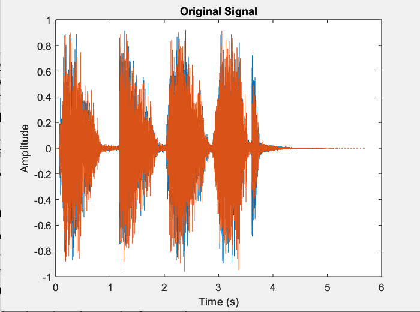 | 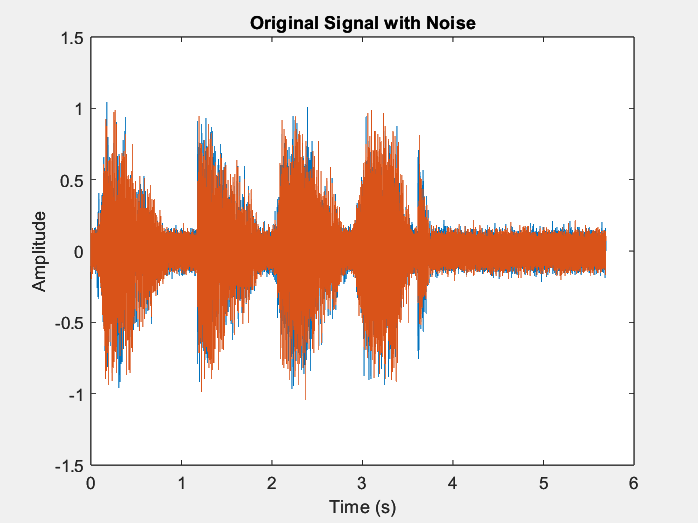 | 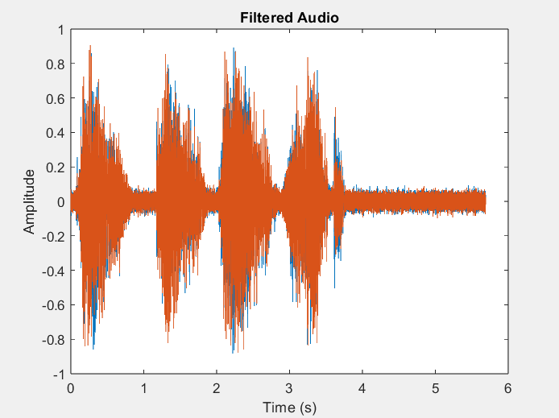 |

### Frequency domain

Because of the white noise, the noisy spectrum extends across all frequencies. After filtering, the high-frequency content drops off above about 3 kHz, which matches the filter design.

| Original | With noise | Filtered |
|:---:|:---:|:---:|
| 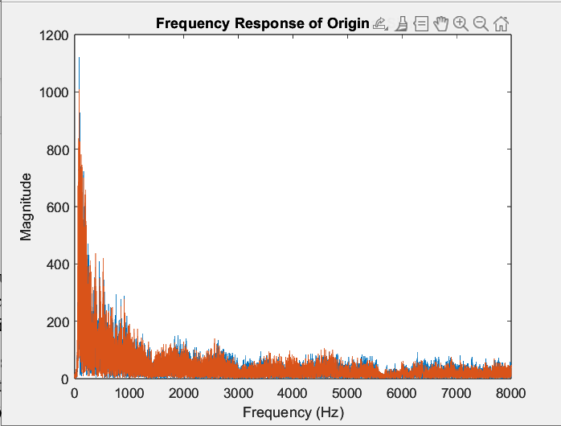 | 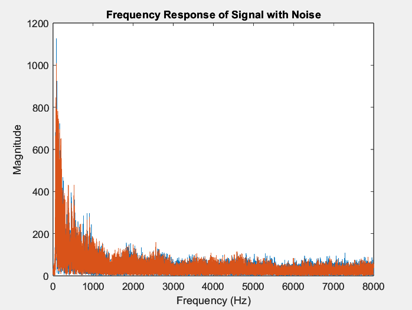 | 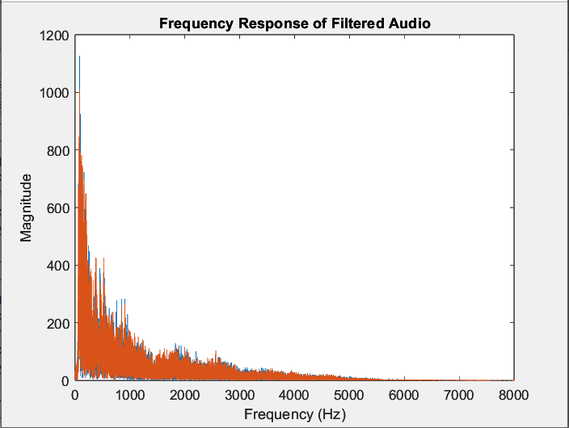 |

---

## Cases where the filter does not work well

### Noise level 0.6

When the noise level is raised to 0.6, the noise is much stronger than the signal and the filter cannot recover the original audio.

| Original | With noise | Filtered |
|:---:|:---:|:---:|
| 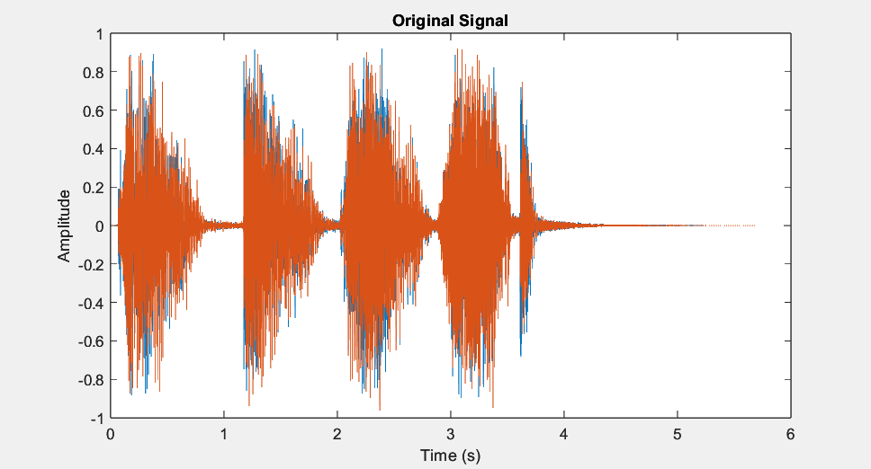 | 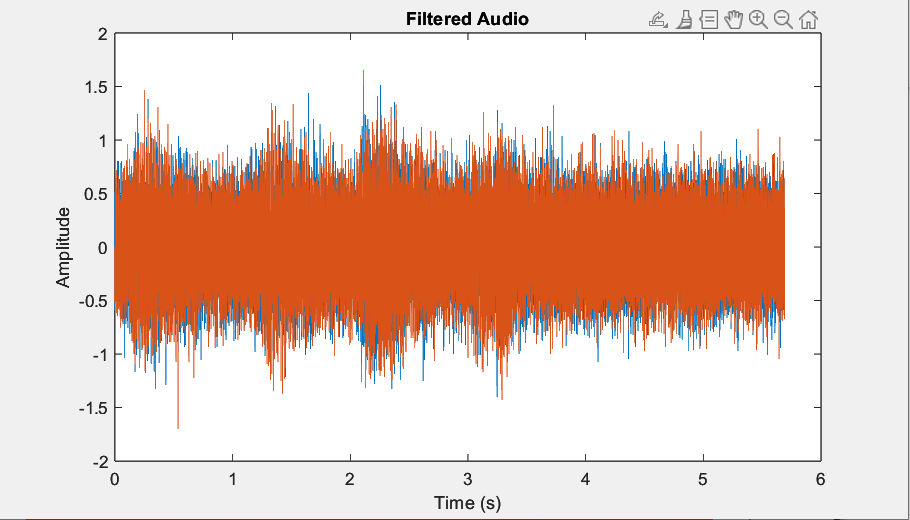 | 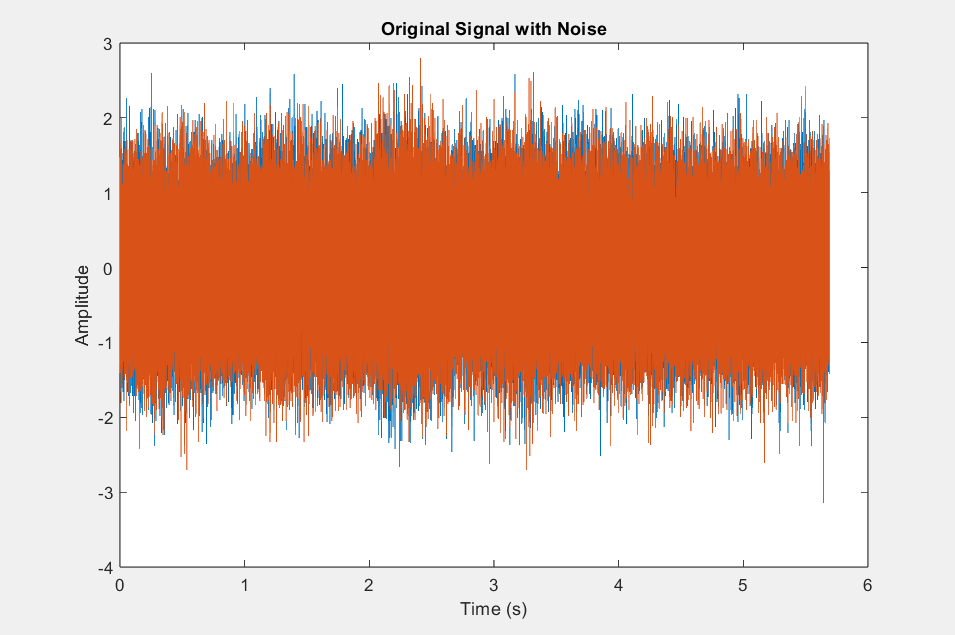 |

### Filter order 1

A first-order filter has a very slow roll-off, so most of the noise passes through.

| With noise | Filtered (order 1) |
|:---:|:---:|
| 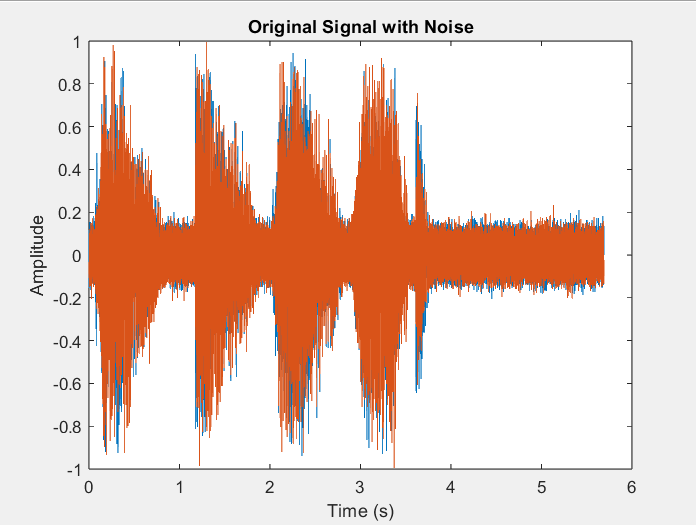 | 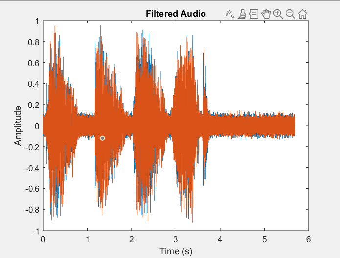 |

---

## Limitations

- White noise is a simple model. Real background noise, such as traffic or crowds, is usually not white.
- The 3 kHz cutoff was chosen by hand and may not suit every speaker or recording.
- A low-pass filter also removes useful high-frequency sound.
- With a high noise level or a low filter order, the output stays noisy.

## Future work

- Use spectral subtraction to remove specific parts of the noise.
- Try adaptive filters for cleaner audio.
- Test a band-pass filter instead of a low-pass filter.
- Use a higher filter order or a different window for a sharper cutoff.

## Conclusion

A low-pass FIR filter designed with `fir1` reduces the white Gaussian noise added to an audio signal. The time-domain plots show a cleaner waveform, and the frequency-domain plots show the high frequencies reduced above the 3 kHz cutoff. The quality of the result depends on the noise level and the filter order.

## References

1. ScienceDirect Topics, [Finite Impulse Response Filter](https://www.sciencedirect.com/topics/computer-science/finite-impulse-response-filter)
2. VEED, [Remove Background Noise from Audio](https://www.veed.io/tools/remove-background-noise-from-audio)
3. MathWorks, [Read and Get Information About Audio Files](https://www.mathworks.com/help/matlab/import_export/read-and-get-information-aboutaudio-files.html)
